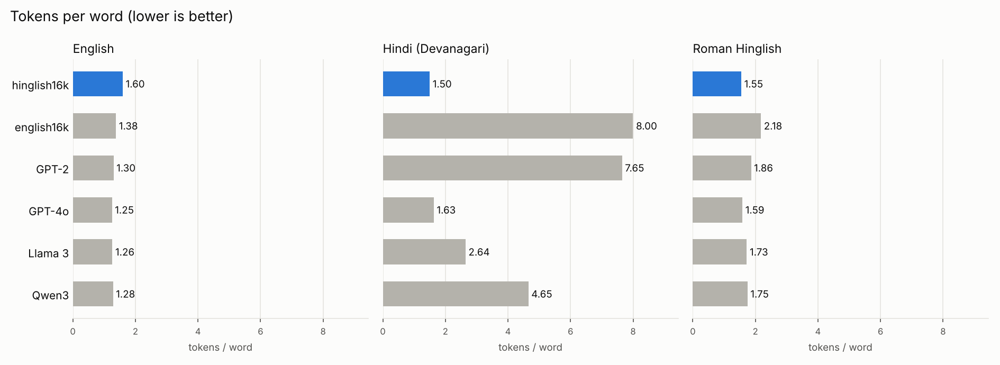
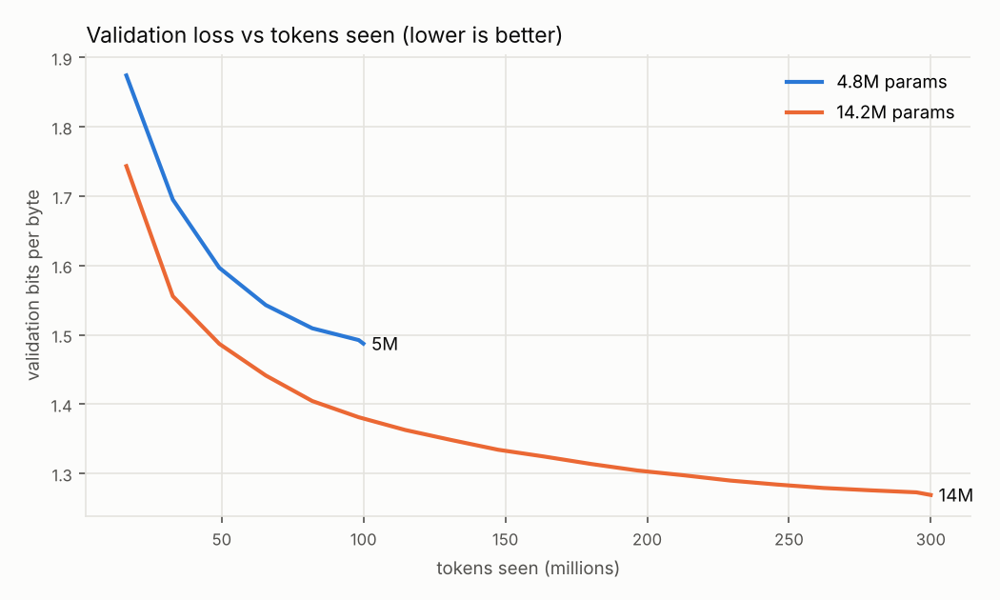
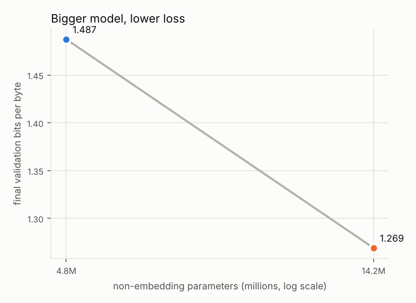
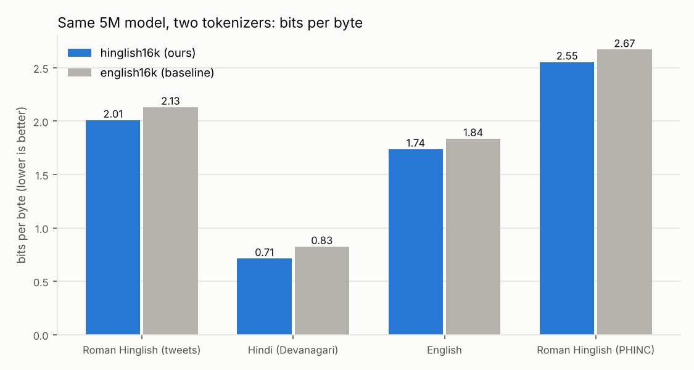
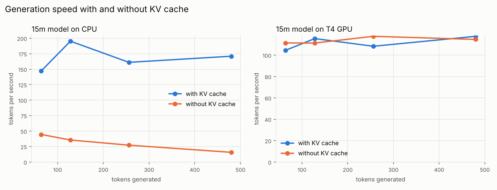

# Hinglish-nanoLM

A from-scratch learning project: build a **Hinglish tokenizer** and pretrain a **small GPT**
(5M–30M parameters) on Roman Hinglish, Devanagari Hindi and a little English, in plain
PyTorch. Then measure two things:

1. **How unfair big-model tokenizers are to Hindi/Hinglish** (GPT-4o, Llama 3, Qwen3 vs mine).
2. **How loss scales with model size**, and whether a Hinglish tokenizer beats an
   English-only one at the same model size (measured fairly, in bits per byte).

Everything except the reference tokenizers is written by hand: data cleaning, MinHash
deduplication, BPE, the transformer, the training loop, evaluation.

## Status

| Milestone | State |
|---|---|
| M0 Scaffold (uv, device auto-detect, tests) | ✅ |
| M1 Corpus pipeline (clean, MinHash dedup, split) | ✅ built: 4.6M docs, 1.45 GB |
| M2a From-scratch BPE (merge loop written by me) | ✅ |
| M2b Production tokenizer + comparison vs GPT-4o / Llama 3 / Qwen3 | ✅ code · ⏳ run `notebooks/02_tokenizer.ipynb` |
| M3 GPT model (RoPE, RMSNorm, SwiGLU, KV cache, sampling) | ✅ code + tests |
| M4 Trainer (AdamW, cosine LR, AMP, resumable checkpoints, W&B) | ✅ code + tests |
| M5 Experiments (3 sizes, bits-per-byte, KV-cache speed) | ✅ code · ⏳ run `notebooks/03_train.ipynb` |
| M6 Write-up | ✅ explanations · ⏳ result numbers |

---

## Results

> ⏳ Plots and numbers appear here after running notebooks 02 and 03
> (files land in `plots/` and `results/`).

### 1. Tokenizers: tokens per word (lower is better)



Full table: [`results/tokenizer_comparison.md`](results/tokenizer_comparison.md) ·
how each tokenizer cuts example sentences: [`results/segmentations.md`](results/segmentations.md)

*What to look for:* English-centric tokenizers need several tokens per Hindi word (the
"Hindi tax"); `english16k` shows the extreme case. Bigger vocabularies (GPT-4o 200k, Qwen3
151k) partly make up for it. `hinglish16k` is only 16k tokens but spends them on these
languages.

### 2. Loss vs model size and tokens seen

 

### 3. Hinglish vs English-only tokenizer, same model size (bits per byte)



### 4. Generation speed with and without KV cache



### 5. Samples

See `results/samples_*.md`. A 30M model trained for a few hours won't be smart: expect
fluent-looking Hinglish with little meaning. That's normal at this scale.

---

## How it works, in simple words

### Data (`src/hnlm/data/`)

| Source | Script | Role | License |
|---|---|---|---|
| [L3Cube-HingCorpus](https://github.com/l3cube-pune/code-mixed-nlp) | Roman Hinglish (tweets) | train | CC BY-NC-SA 4.0 |
| [AI4Bharat Sangraha](https://huggingface.co/datasets/ai4bharat/sangraha) (verified, Hindi) | Devanagari | train | CC BY 4.0 |
| [FineWeb-Edu](https://huggingface.co/datasets/HuggingFaceFW/fineweb-edu) (small slice) | English | train | ODC-By 1.0 |
| [PHINC](https://huggingface.co/datasets/veezbo/phinc) | Roman Hinglish | held-out eval | CC BY 4.0 |

After cleaning and MinHash dedup:

| Source | Raw docs | Kept docs | Kept MB | Removed as duplicates |
|---|---:|---:|---:|---:|
| HingCorpus | 6,917,003 | 4,474,333 | 447 | 1,980,280 (31%) |
| Sangraha Hindi | 160,326 | 157,070 | 859 | 3,060 (2%) |
| FineWeb-Edu | 30,491 | 30,436 | 144 | 5 |
| PHINC (eval) | 13,738 | 12,806 | 0.9 | 179 |

- **Cleaning** (`clean.py`) removes URLs, @mentions, emoji and "RT", shortens "sooooo" to
  "sooo", applies Unicode NFC (one byte form per visible character), keeps the invisible
  joiners that change how Hindi conjuncts render, and labels each doc as Devanagari / Latin /
  mixed. Gotcha: Hindi vowel signs (ि ी ं) are Unicode *marks*, not letters, so every
  "is this a letter?" check must accept marks too.
- **Near-duplicate removal** (`dedup.py`, MinHash + LSH written in numpy): turn each doc into
  a set of 5-character pieces; squash the set into 64 numbers (MinHash) so that *the fraction
  of matching numbers ≈ how similar two docs are*; group docs whose signatures match in at
  least one of 16 bands (fast, by sorting); verify; keep one per group. Tweets lost 31%
  (retweets, forwards), curated web text only 2%.
- **Train/val split** (`split.py`) is decided by a hash of the text, so re-running never moves
  a document from validation into training.

### Tokenizer (`src/hnlm/tokenizer/`)

- **Byte-level BPE** (`bpe_scratch.py`, merge loop written by me): start from the 256 byte
  values, so nothing is ever "unknown". Repeatedly find the most frequent neighbouring pair
  and merge it into a new token. The very first merge learned on our data is `E0 A4`: the
  first two bytes of most Devanagari letters (each Hindi letter is 3 bytes in UTF-8).
- **Pre-tokenization** (`pretokenize.py`): split text into words before BPE. I use GPT-4's
  pattern with one fix: GPT-4's `\p{L}` (letters) misses Hindi vowel signs, which cuts every
  Hindi word apart at each matra. Adding `\p{M}` keeps Hindi words whole.
- **Production version** (`train_hf.py`): the same recipe in Hugging Face `tokenizers` (Rust,
  ~1000× faster), 16,384 tokens. `hinglish16k` trains on equal parts Roman Hinglish and Hindi
  plus some English; `english16k` (baseline) on English only.
- **Why 16k?** In a small model the embedding table is huge relative to the rest: a 32k
  vocab at width 256 is 8.4M parameters, more than the whole 5M model.
- **Metrics** (`compare.py`): *fertility* = tokens per word; *chars per token*; plus example
  segmentations.

### Model (`src/hnlm/model/`), a decoder-only GPT

```
token ids → embedding → [ RMSNorm → attention → + ] → [ RMSNorm → SwiGLU → + ] × N
          → RMSNorm → output layer (shares weights with the embedding) → next-token scores
```

- **Embedding**: each token id becomes a vector of `d_model` numbers.
- **Causal self-attention**: every token builds a *query* ("what am I looking for?"), a *key*
  ("what do I contain?") and a *value* ("what do I pass on?"). Query·key scores say how much
  each earlier token matters; softmax turns them into weights; the output is the weighted
  sum of values. A **causal mask** hides future tokens: no peeking at the answer. Several
  **heads** do this in parallel, each free to track something different.
- **RoPE**: instead of adding a position vector, rotate queries and keys by an angle that
  grows with position. Then q·k depends only on the *distance* between two tokens.
- **RMSNorm**: rescale each vector to a steady size before each sub-layer, which keeps deep
  networks stable. Cheaper than LayerNorm and just as good.
- **SwiGLU**: the per-token MLP, with a learned gate deciding what passes. Used by Llama/Qwen.
- **Residual connections**: each layer *adds* its update to a running "stream", so gradients
  flow easily through many layers.
- **Weight tying**: the input embedding and the output layer share one matrix (saves
  4–8M parameters here).
- **KV cache**: during generation, store each layer's keys and values so every new token only
  computes its own, instead of recomputing the whole sequence.
- **Sampling**: *temperature* (sharper or flatter choices), *top-k* (only the k best),
  *top-p* (smallest set covering p probability).

| Size | Layers | Heads | Width | Non-embedding params | Total (with embedding) |
|---|---:|---:|---:|---:|---:|
| 5m | 6 | 4 | 256 | 4.82M | 9.01M |
| 15m | 8 | 6 | 384 | 14.16M | 20.45M |
| 30m | 10 | 8 | 512 | 32.12M | 40.51M |

### Training (`src/hnlm/train/`)

- **Objective**: predict the next token (cross-entropy). That's all pretraining is.
- **Data**: the corpus is tokenized once into flat `uint16` files; each batch picks random
  512-token windows, mixing sources in proportion to their size.
- **AdamW** (β = 0.9, 0.95; weight decay 0.1 on matrices only), **warmup + cosine** learning
  rate, **gradient clipping** at 1.0, **gradient accumulation** (4 × 32 sequences = 65,536
  tokens per step), **mixed precision** (bfloat16 when the GPU supports it, else float16 with
  loss scaling).
- **Budget**: ~20 tokens per non-embedding parameter (the Chinchilla rule of thumb): 100M /
  300M / 600M tokens. The corpus is a few hundred million tokens, so the 30M run sees it
  about twice, which is still fine.
- **Checkpoints that survive Colab disconnects**: written atomically to Google Drive every
  250 steps. Batches are seeded by step number, so a resumed run is **bit-for-bit identical**
  to an uninterrupted one (there's a test for this).
- **Logging**: CSV always, Weights & Biases when a key is set.

### Evaluation (`src/hnlm/eval/`)

- **Bits per byte (BPB)** = total loss in bits ÷ number of UTF-8 bytes of the text. Per-token
  loss can't compare two tokenizers (one makes fewer, harder predictions); per *byte* of the
  same text it can. Reported separately for Roman Hinglish, Hindi, English and PHINC.

---

## Reproduce

Step-by-step (with secrets setup and what to do on disconnects): [`docs/RUN_CHECKLIST.md`](docs/RUN_CHECKLIST.md).

| Step | Where | Notebook | Time |
|---|---|---|---|
| 1. Build corpus | Colab CPU | `notebooks/01_prepare_data.ipynb` | ~1 h |
| 2. Train + compare tokenizers | Colab CPU | `notebooks/02_tokenizer.ipynb` | ~20 min |
| 3. Train models + experiments | Colab **T4 GPU** | `notebooks/03_train.ipynb` | many hours (the 15M run alone takes ~6 h on a free T4), resumable |

Laptop (CPU) development:

```bash
uv sync                      # Python 3.12 + deps
uv run pytest                # 54 tests, all on CPU, ~10 s
uv run python scripts/train_bpe_scratch.py --vocab-size 400
```

### Tests (`tests/`)

Tokenizer round-trip (scratch + production, incl. Hindi, emoji, odd whitespace) · attention
causality (changing a future token never changes earlier outputs) · KV-cache output equals
full forward · overfit one batch · RoPE depends only on relative position · sampling
controls · cleaning / dedup / split · byte accounting for BPB · LR schedule · end-to-end
training · bit-exact resume.

---

## What I learned

*(Draft. Finalized with the experiment results.)*

- Tokenizers carry hidden assumptions: one regex class (`\p{L}` without `\p{M}`) is enough to
  make a tokenizer bad at Hindi.
- Data work is most of the work, and measuring beats guessing: cleaning ran 18× slower on
  Colab than on my laptop because the bottleneck was writing to Google Drive, not the code.
- Social-media text is extremely repetitive (31% near-duplicates).
- Small details make training robust: atomic checkpoints, seeding batches by step, testing
  that resuming changes nothing.

## Limitations

- Small models and a few hundred million tokens: good for learning and for *relative*
  comparisons, not a useful assistant.
- Tweets dominate the Roman-script data, so the model's Roman Hinglish is "Twitter style".
- Vocab sizes differ between my tokenizer (16k) and the big ones (128k–200k), so tokenizer
  comparisons mix "what it was trained on" with "how big it is". The 16k-vs-16k BPB
  experiment controls for that.

## License

HingCorpus is **CC BY-NC-SA 4.0** (non-commercial, share-alike), so the trained tokenizers and
models from this project are shared under the same terms. Code: same, for simplicity.
Other datasets: see the table above.
